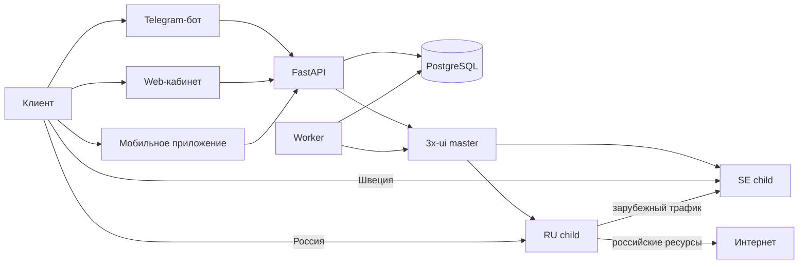

# Freedom VPN

Сервис продажи, выдачи и продления VPN-доступа. Состояние пользователей,
платежей и подписок хранится в PostgreSQL. Сетевые подключения и учёт трафика
управляются через REST API нашего fork 3x-ui master; child-ноды запускают Xray.

## Состав

| Каталог | Назначение |
| --- | --- |
| `api/app` | FastAPI, web-кабинет, admin, платежи, выдача ключей |
| `bot/app` | Telegram-бот на aiogram 3 |
| `alembic/versions` | Миграции PostgreSQL |
| `scripts` | Операционные проверки и host-only обслуживание |
| `deploy` | systemd, конфигурация нод и Docker-образ 3x-ui + KIT |
| `tests` | Тесты API, жизненного цикла и интеграции 3x-ui |
| `3x-ui` | Справка по API и настройкам панели |



Фактические адреса, профильные порты и маршруты на 17 октября 2026 года
описаны в [архитектуре](docs/architecture.md). API не запускает собственный Xray
и не управляет child-нодами по SSH. Подписка клиента может содержать несколько
шведских и российских профилей при одной личности `vpn-<client_id>`.

## Локальный запуск

Создайте `.env` по используемому окружению и проверьте его:

```bash
python3 scripts/configctl.py validate
docker compose run --rm api alembic upgrade head
docker compose up -d
```

`docker-compose.yml` запускает `api`, `worker` и `bot`. PostgreSQL и 3x-ui
master существуют отдельно. Для выдачи VPN нужен доступный master, Bearer token
панели и настроенная логическая VPN-нода.

При разработке API использует `http://localhost:8000`; `/health` проверяет
процесс, а `/db-health` требует служебную авторизацию и проверяет PostgreSQL.
Операционный порядок бэкапа, миграции и деплоя описан в
[обслуживании](docs/maintenance-scripts.md).

## Документация

Полный каталог, сгруппированный по архитектуре, эксплуатации, API и клиентам:
[docs/README.md](docs/README.md). Начните с [архитектуры](docs/architecture.md).
Материал в `3x-ui/` относится к API панели; реальная конфигурация нод хранится
в самих панелях и не заменяется текстом из репозитория.

## Проверка кода

```bash
python3.13 -m venv .venv
.venv/bin/pip install -r api/requirements-dev.txt
.venv/bin/python -m unittest discover -s tests -v
```

Секреты `.env`, полные VPN URI, ключи Reality и токены 3x-ui в Git не
попадают. Скрипты и код в репозитории не являются резервной копией SQLite
child-панелей или PostgreSQL сервиса.
