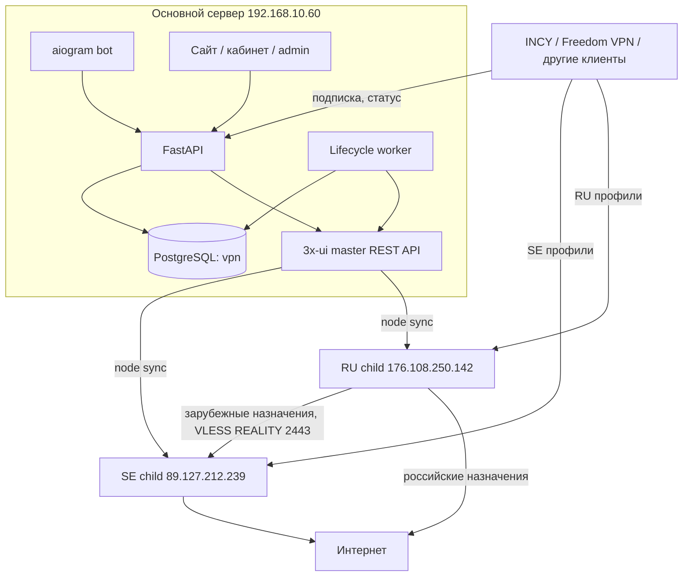
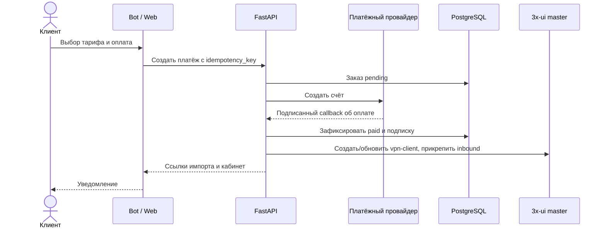

# Архитектура на 17 октября 2026 года

Источник истины для коммерческого доступа — PostgreSQL сервиса. Источник истины
для активных Xray inbound и клиентов — 3x-ui master. Child-панели получают
конфигурацию через встроенную синхронизацию 3x-ui. Файлы в репозитории не
содержат действующие ключи и не являются снимком баз панелей.

## Компоненты и границы

`docker-compose.yml` содержит `vpn-api`, `vpn-worker` и `vpn-bot`. PostgreSQL
работает отдельно в контейнере `postgres`; master 3x-ui на хосте запущен через
`systemd`. API-контейнер достигает локального master через
`vpn-threexui-proxy.service`. В приложении нет своего Xray и node-agent.

## Идентификаторы и профили

`VPNNode` — коммерческая локация; `VPNNodeConfig` хранит адрес API master,
главный inbound и дополнительные `kit_inbound_ids`. У 3x-ui собственные ID
child-нод и inbound. Эти ID из разных систем не взаимозаменяемы.

На текущем стенде логическая SE-нода имеет ID 3, RU-нода — ID 4; действующая
RU child в master — node 8. RU профили master имеют inbound ID 28–36:

| Профиль | Вход на RU | Выход для зарубежных ресурсов |
| --- | --- | --- |
| VLESS REALITY | TCP 443 | SE transit |
| VLESS REALITY-2 | TCP 23691 | SE transit |
| Hysteria2 | UDP 443 | SE transit |
| VLESS XHTTP + REALITY | TCP 8443 | SE transit |
| VLESS WebSocket + TLS | TCP 2081 | SE transit |
| Trojan gRPC + TLS | TCP 2083 | SE transit |
| VMess WebSocket + TLS | TCP 2087 | SE transit |
| TUIC | UDP 8444 | SE transit |
| WireGuard | UDP 51820 | SE transit |

Включённые профили клиента экспортируются через API master и KIT-подписку.
Клиент с логической SE-нодой может получить также RU-профили по
`alternate_node_ids`; provisioning и reconciliation прикрепляют одну и ту же
личность `vpn-<client_id>` к нужным inbound. Ранее выключенная RU-нода не
должна попадать в новые подписки. Часть форматов приложений поддерживает только
подмножество протоколов; полный список доступен в выдаче ключей и сырой
подписке.

## Маршрутизация RU

Xray child читает `xrayTemplateConfig` и применяет первое совпавшее правило.
Для всех девяти входящих порядок сейчас такой:

1. Служебный API, private IP и BitTorrent обрабатываются отдельно.
2. Домены `ext:geosite_RU.dat:ru-blocked` направляются через `cascade-sweden`.
3. `ru-available-only-inside`, `geosite:category-ru` и `geoip:ru` идут в
   `direct`, то есть в интернет с RU IP.
4. Остальные назначения идут в `cascade-sweden` по REALITY на
   `89.127.212.239:2443`.

`domainStrategy=AsIs`; на inbound включён sniffing HTTP/TLS/QUIC. Xray
загружает `geosite.dat`, `geoip.dat` и дополнительный `geosite_RU.dat` из
каталога assets. Проверка маршрутов через `POST /panel/api/xray/routeTest`
17 октября дала `direct` для `yandex.ru` и `77.88.8.8`,
`cascade-sweden` для `youtube.com` и `8.8.8.8` на всех девяти тегах.
Команды обновления и проверки списков приведены в
[обслуживании](maintenance-scripts.md#ru-нода-профили-и-раздельная-маршрутизация).

## Покупка и выдача

Ручные платежи, Telegram Stars и Platega проходят разные точки подтверждения;
сам вызов создания платежа не даёт VPN-доступ. Повторный оплаченный заказ
продлевает существующую активную подписку, сохраняя UUID и ссылку клиента.
Операция перевыпуска ключа создаёт новую клиентскую версию и отзывает старую.
Worker под advisory lock завершает истёкший доступ, отправляет напоминания и
сверяет прикрепление клиентов к inbound master.

## Подписки и приложения

`/v1/client/subscription/{token}` выдаёт подписанную ссылку на набор профилей.
`/v1/client/profile` возвращает профиль активированного устройства, лимиты,
срок и поддерживаемые им подключения. Web-кабинет и бот предлагают копирование
ключа/QR с выбором профиля и импорт в Freedom VPN, INCY, Amnezia VPN и
V2rayTUN. KIT `kit-sub` работает как прокси перед встроенной подпиской 3x-ui
и меняет формат в зависимости от приложения; его конфигурация хранится на
каждой ноде отдельно.

Секреты API, приватные ключи и полные VPN URI не входят в документацию.
Порядок бэкапа, восстановления, SSL и мониторинга указан в
[обслуживании](maintenance-scripts.md).
